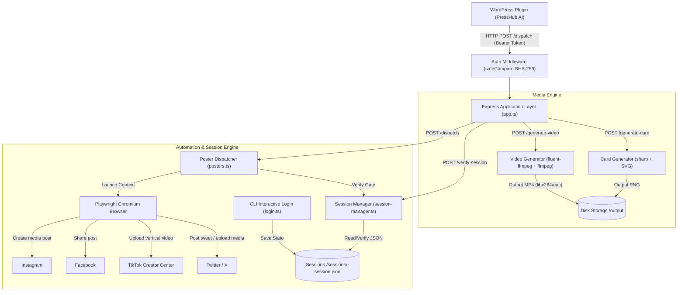

# PressHub Social Worker — Architecture & Data Flow

## Security & Architecture Principles

1. **Constant-Time Verification**: Shared secret comparison hashes both candidate and stored secret with SHA-256 prior to `crypto.timingSafeEqual`, preventing timing attacks and buffer length leakage.
2. **Path Traversal Guards**: The platform string is strictly validated against an immutable allowlist (`['twitter', 'tiktok', 'facebook', 'instagram']`) to prevent directory traversal or file injection attacks.
3. **Fail-Fast Session Gate**: All automation handlers inspect the session storage state before launching browser instances. If cookies are missing or all expired, the worker immediately rejects the request with an actionable command message (`npm run login -- <platform>`).
4. **Resilient Media Compositing**: Video generation automatically injects a silent audio track (`anullsrc`) if an external voice file is not attached, ensuring platforms like TikTok that require audio streams accept the upload without re-encoding errors.
5. **Decoupled Testability**: The Express app factory accepts injected poster handlers, enabling complete end-to-end unit testing without launching heavy browser instances during CI.
