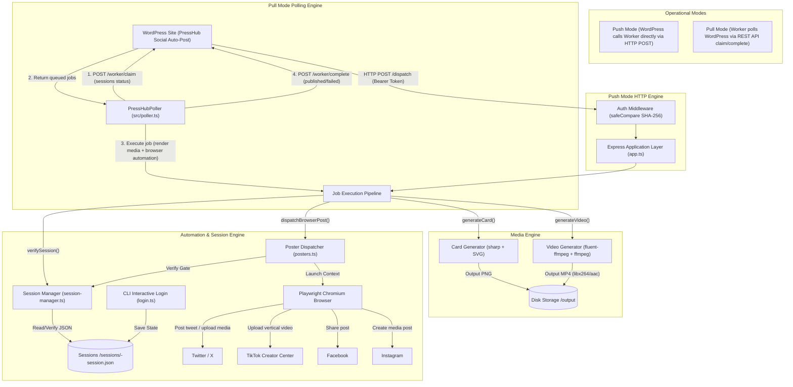

# PressHub Social Worker — Architecture & Data Flow

## Security & Architecture Principles

1. **Dual Push/Pull Operational Modes**:
   - **Pull Mode (Recommended for Local PCs / Behind NAT)**: The worker polls `PRESSHUB_WP_URL` periodically, claiming automation jobs and reporting completion status back to `/wp-json/presshub-social/v1/worker/complete`. Zero inbound firewall ports or public IP addresses required.
   - **Push Mode**: WordPress connects directly to worker's HTTP port (`POST /dispatch`) when the worker is hosted on a publicly reachable server.
2. **Zero-Dependency .env Configuration**: Loads `PRESSHUB_WP_URL`, `PRESSHUB_WORKER_SECRET`, `PRESSHUB_WORKER_PORT`, and `PRESSHUB_POLL_INTERVAL_MS` from `.env` on startup without overriding pre-set system environment variables.
3. **Constant-Time Verification**: Shared secret comparison hashes both candidate and stored secret with SHA-256 prior to `crypto.timingSafeEqual`, preventing timing attacks and buffer length leakage.
4. **Path Traversal Guards**: The platform string is strictly validated against an immutable allowlist (`['twitter', 'tiktok', 'facebook', 'instagram']`) to prevent directory traversal or file injection attacks.
5. **Fail-Fast Session Gate**: All automation handlers inspect the session storage state before launching browser instances. If cookies are missing or all expired, the worker immediately rejects the request with an actionable command message (`npm run login -- <platform>`).
6. **Resilient Media Compositing**: Video generation automatically injects a silent audio track (`anullsrc`) if an external voice file is not attached, ensuring platforms like TikTok that require audio streams accept the upload without re-encoding errors.
7. **Observable Poller & Automation Diagnostics**: Every poll cycle emits timestamped diagnostics including active session presence, claim status (`claimed 0 jobs (queue is empty or no due automation jobs)`), and step-by-step browser progress. Automation errors trigger automatic full-page screenshot capture to `output/debug-error-<platform>-<timestamp>.png`.
8. **Strict-Mode Compliant Browser Locators & Overlay Resilience**: All Playwright locators across Twitter/X, TikTok, Facebook, and Instagram use `.first()` and prioritize active modal dialog containers (`div[role="dialog"]`) over background timeline composers. Both Twitter and TikTok posters auto-dismiss cookie consent banners, automatic content checks dialogs, and onboarding tooltips before posting. When backdrop elements or translucent masks intercept pointer events, handlers fall back to actionability force-clicks (`{ force: true }`).
9. **Configurable Headless Mode & Stealth Execution**: Configured via `PRESSHUB_HEADLESS` in `.env` (defaulting to `false` for visible Chrome to avoid bot detection and provide live visual inspection).
10. **Branded Media Generation**: Resolves post featured images and podcast audio attachments dynamically from WordPress REST APIs (`_embed`). Composites site logo (`cropped-PressHub-Cy-ICON.png`) and podcast mic (`PressHub.cy Mic.png`) into cards and videos matching website branding (dark slate/navy `#0f172a`, electric blue/cyan `#0284c7`, accent crimson `#e11d48`).
11. **Decoupled Testability**: All core poller, poster, and media methods support dependency injection for clean unit testing without external network or browser dependencies.
